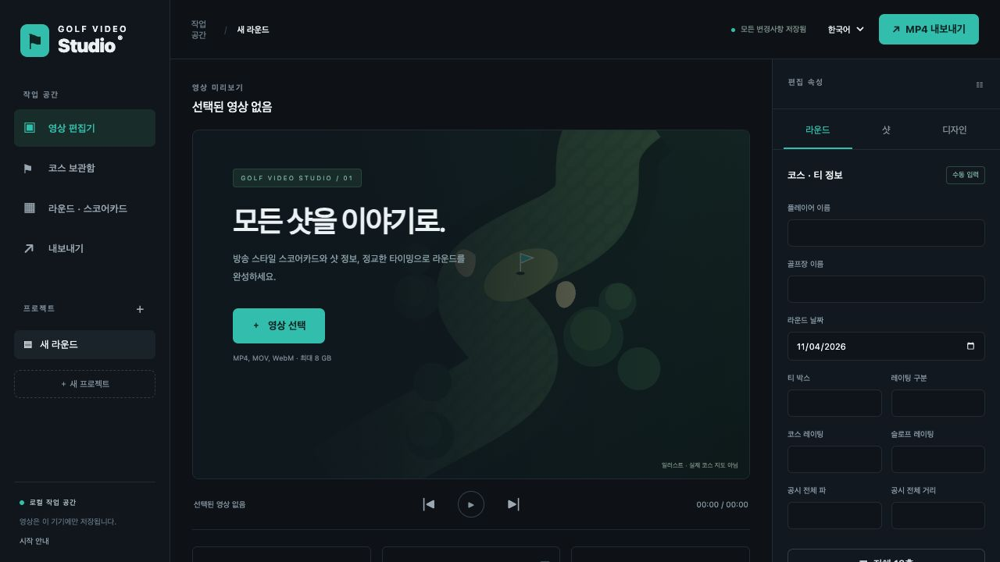
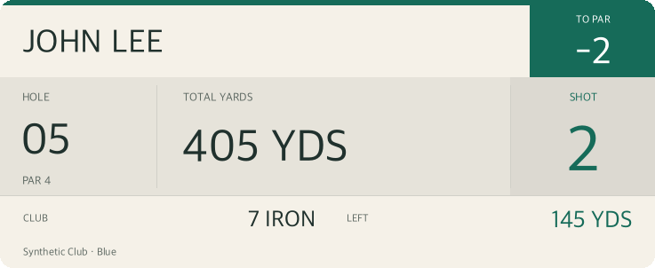
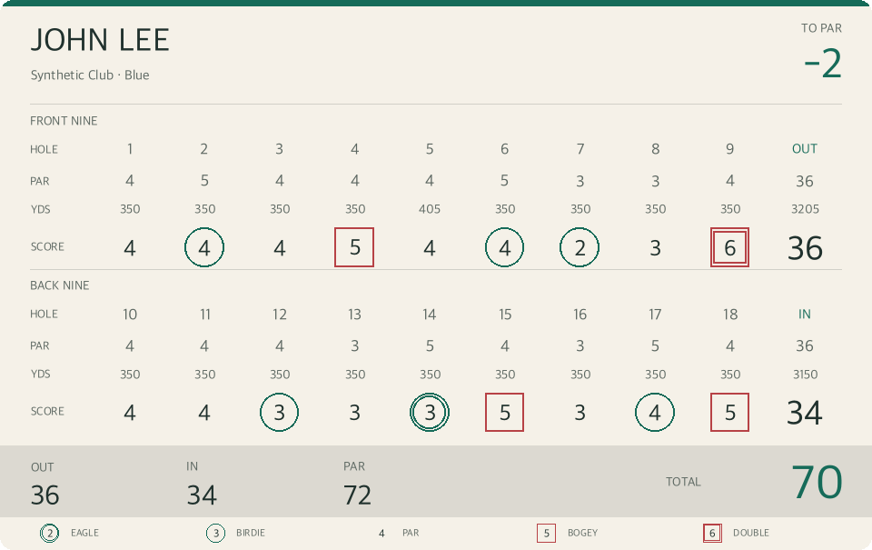

[English](README.md) | **한국어**

# Golf Video Studio

샷 그래픽과 편집 가능한 18홀 스코어카드를 영상 시간에 맞춰 표시하고 실제 MP4에 합성하는 로컬 골프 영상 편집기입니다. 영상 처리와 프로젝트 저장은 사용자 기기에서 실행합니다. 웹 편집기와 Expo 모바일 개발 클라이언트가 하나의 FastAPI 백엔드와 점수 모델을 공유합니다.



## 현재 상태

| 구성 요소 | 상태 |
| --- | --- |
| 데스크톱 웹 편집기 | 영상 가져오기·재생, 라운드·샷 입력, 타임라인, 오버레이 디자인, 프로젝트 저장 구현 |
| MP4 내보내기 | 실제 FFmpeg H.264/AAC 렌더링·진행률·다운로드 및 공통 미리보기·출력 그래픽 구현 |
| 코스 보관함 | 로컬 검색, 티·레이팅 구분 선택, 수동 입력, 허가된 CSV/JSON 가져오기 구현 |
| GolfCourseAPI | API 키 설정, 온라인 이름 검색, 티·레이팅 구분·홀 정보 가져오기, 24시간 캐시 구현. 사용자 키 필요 |
| iOS / Android | Expo 개발 클라이언트 준비, 타입 검사·양쪽 JavaScript 번들 검증 통과, 네이티브 빌드·실기기 검증 대기 |
| USGA / 클라우드 | USGA 실시간 연동, 운영 인증·저장소, 스토어 게시 대기 |

**검증:** 합성 영상·오디오 출력과 미리보기 패널 비교를 포함한 백엔드 테스트 122개와 JavaScript 테스트 11개를 통과했습니다. 브라우저에서 업로드·샷 오버레이·자동 저장·실제 MP4 출력 완료를 확인했습니다. [구현 상태](docs/STATUS.md)와 [설계 문서](docs/ARCHITECTURE.md)를 참고하세요.

## 실행

Python 3.13 이상, [uv](https://docs.astral.sh/uv/), PATH에 등록된 **ffprobe·libx264 포함 FFmpeg**가 필요합니다.

```bash
git clone https://github.com/slee1005/scorecard.git
cd scorecard
uv sync --locked
uv run golf-video-studio
```

[http://127.0.0.1:8775](http://127.0.0.1:8775)를 여세요. 다른 포트는 `--port 8780`으로 지정합니다. macOS는 `brew install ffmpeg`로 설치할 수 있습니다. Windows/Linux는 운영체제에 맞는 FFmpeg와 ffprobe 실행 파일을 PATH에 등록하세요. 프런트엔드 빌드, 클라우드 계정, API 키는 필요 없습니다.

## 편집 순서

1. 프로젝트를 만들고 MP4·MOV·WebM을 가져옵니다. 프로젝트마다 원본 영상 1개를 저장합니다. 회전을 반영한 해상도, 길이, FPS, 오디오 유무를 표시합니다. 재생 가능 여부는 브라우저 코덱 지원에 따라 달라지므로 H.264 MP4를 권장합니다.
2. 플레이어, 골프장, 티, 레이팅 구분, 날짜, 선택적인 공시 코스·슬로프 레이팅을 입력합니다. **라운드 · 스코어카드**에서 18홀의 파·거리·스코어를 입력합니다. 모르는 값은 빈칸으로 유지합니다. 전반·후반·전체 합계는 입력한 홀만, 기준 타수 대비는 스코어와 파를 모두 아는 홀만 계산합니다.
3. 클럽·홀·샷 거리·남은 거리·결과·메모·시작/종료 시간을 입력합니다. 목록 순서에 따라 홀별 샷 번호를 자동 계산하며 위/아래 버튼으로 순서를 바꿉니다. **샷** 속성의 샷 번호에 1~99를 입력하면 표시 번호를 수동 지정합니다. 비우면 자동 번호로 복원됩니다. 수동 번호는 순서를 바꿔도 유지되며 다른 샷의 번호 계산에는 영향을 주지 않습니다. 새 샷은 마지막 샷 뒤의 사용 가능한 시간에 배치합니다. 시간 입력 또는 타임라인 마커 드래그로 이동하세요.
4. 전체·전반·후반 스코어카드를 추가합니다. 타임라인 그래픽을 선택하고 **디자인**에서 템플릿, 표시 구간, 비율 좌표·크기, 글꼴, 글자·배경·강조색, 배경 불투명도, 모서리, 표시 여부, 코스 표시를 편집합니다. 미리보기에서 패널과 크기 핸들을 드래그할 수 있습니다. 방송 블루·포레스트·오션·페이퍼·크림슨·미드나이트 색상 테마와 사용자 지정 색상을 지원합니다. **팝업 전체 투명도**는 0%(표시)~100%(완전 투명)로 글자·패널 전체에 적용하며, **배경 불투명도**는 배경에만 적용합니다. 테마를 바꿔도 투명도·표시 시간·위치는 유지합니다. 스타일을 프로젝트 프리셋으로 저장합니다. 서로 다른 영역의 샷·스코어카드는 함께 표시할 수 있으며 의도치 않은 구간·패널 충돌은 거부합니다.
5. 재생·일시정지·탐색·프레임 이동·타임라인 확대를 이용합니다. 입력 컨트롤에 포커스가 없을 때 스페이스는 재생, 방향키는 프레임 이동입니다. 실제 영상의 `currentTime`을 기준으로 `[시작, 종료)` 구간에 그래픽을 표시합니다. 탐색 막대·눈금·재생선·샷과 그래픽 행은 하나의 확대·스크롤 시간 축을 공유합니다. 확대 시 화면 안의 재생선 위치를 유지하고 화면 밖이면 현재 보이는 영역의 중심을 유지합니다. 짧은 마커도 실제 구간 길이대로 표시하며 탐색·드래그에 확대 배율과 가로 스크롤을 반영합니다.
6. **MP4 내보내기**에서 초안·고품질·최고 품질과 원본·1080p·4K 범위를 선택합니다. 화면 비율과 오디오를 유지하며 영상은 H.264/yuv420p, 첫 오디오 트랙은 AAC로 인코딩합니다. 원본보다 확대하지 않습니다. FFmpeg의 실제 진행률을 표시하며 내보내기 화면에서 MP4를 다운로드합니다.

**기본 배치:** 새 샷 팝업은 가로 위치 **0.75**, 세로 위치 **0.03**, 너비 **0.2**, 높이 **0.15**입니다. 새 전체·전반·후반 스코어카드는 가로 위치 **0.24**, 세로 위치 **0.2**, 너비 **0.504**, 높이 **0.56**입니다. 둘 다 글자 크기 **30**, 모서리 **20**, 고딕 글꼴, 배경·코스 정보 표시를 기본으로 사용합니다. 좌표는 영상 프레임에 대한 비율이며 가로·세로 영상에서 같은 값을 사용합니다. 웹·모바일에서 새로 추가할 때와 디자인 RESET에 적용합니다. 저장한 스타일은 유지하고 별도의 추천 배치 버튼은 원본 화면 비율에 맞춰 조정합니다.

**방송형 그래픽:** 샷 팝업에 라운드의 플레이어 이름, 해당 샷의 현재 홀 이전까지의 누적 파 대비 타수, 홀·파, 크게 표시한 남은 거리, 큰 샷 번호와 하단 클럽·홀 전체 거리를 표시합니다. 방송형 배치는 HOLE·PAR·LEFT·TO PAR 라벨과 클럽 글자를 확대하고 글자 크기 설정에 함께 반응합니다. 전체 거리는 선택한 홀의 거리이며 개별 샷 거리와 구분합니다. 현재 홀과 이후 홀은 점수가 입력되어 있어도 제외합니다. 1번 홀은 E로 시작하고 이전 홀의 파·점수가 하나라도 빠지면 누적 스코어를 미상으로 표시합니다. 홀의 파·거리도 임의로 추정하지 않습니다. 미니멀 템플릿은 개별 샷 거리를 계속 표시합니다.



**모던 스코어카드:** 전체 카드는 전반·후반 9홀을 두 단으로 정렬하고 파·거리·스코어, 전후반 합계, 전체 파·스코어와 타수 기호를 표시합니다. 전반·후반 템플릿은 해당 9홀만 표시합니다. 버디·이글의 원과 보기·더블보기의 네모는 숫자의 실제 픽셀 영역과 같은 중심을 사용합니다. 두 자리 숫자와 미입력 대시도 처리하며, 편집용 스코어 입력란의 기호도 입력 테두리와 분리해 가운데에 맞춥니다.



새 그래픽은 영상 비율을 고려한 추천 크기·위치를 사용합니다. 기존 프로젝트의 색상·크기·시간·투명도는 유지합니다. 이전의 넓고 납작한 카드에는 **디자인 → 추천 크기 · 위치 적용**을 누른 뒤 필요에 따라 크기·위치를 조절하세요. **모든 그래픽에 색상 적용**은 선택한 팝업의 세 색상만 프로젝트 전체에 적용하며 시간·위치·글꼴·투명도는 바꾸지 않습니다. 네이티브 미리보기도 같은 서버 생성 패널을 받습니다.

Pillow로 만든 동일한 RGBA 패널을 브라우저에 표시하고 출력 영상에 합성합니다. 위치는 레터박스가 아닌 실제 영상 영역을 기준으로 하며 세로 영상도 지원합니다. 세로 영상에서는 전반·후반 카드 또는 큰 패널로 가독성을 확보하세요. 미리보기는 실제 영상과 투명 이미지 레이어를 사용하며 재생 중에만 `requestAnimationFrame`을 실행합니다. 캔버스용 별도 글자 렌더러를 만드는 대신 출력과 같은 이미지를 사용합니다.

## 코스와 데이터 무결성

### GolfCourseAPI 설정

**코스 보관함 → GolfCourseAPI 연동**에서 키를 입력하고 **API 키 저장**을 누르세요. 코스·클럽 이름으로 **온라인 검색**(또는 Enter)한 뒤 **코스 · 티 가져오기**를 누릅니다. 저장된 코스 카드에서 티와 제공된 `male`/`female` 레이팅 구분을 선택하고 **선택한 티 적용**을 누릅니다. 기존 확인 절차가 라운드 코스값을 보호하며 스코어는 유지합니다. 데이터와 계정 조건은 [공식 API 문서](https://api.golfcourseapi.com/docs/api/)를 참고하세요.

검색은 `GET /v1/search?search_query=…`, 상세는 `GET /v1/courses/{id}`를 사용하며 `Authorization: Bearer …`로 인증합니다. 사용자가 검색·가져오기·갱신을 요청할 때만 로컬 백엔드가 외부 API에 연결합니다. 검색은 티 개수를 표시하며, 선택한 코스를 가져올 때 티별 레이팅·전체 거리·파와 제공된 홀별 파·거리·핸디캡을 불러옵니다. 누락된 홀은 미입력으로 유지합니다. 출처는 **GolfCourseAPI / 가져옴**으로 표시하며 USGA 검증으로 표시하지 않습니다. **최신 버전 가져오기**는 새 코스 버전을 저장합니다. 라운드 적용은 별도 선택·확인을 거칩니다. 검색·상세 응답은 로컬에 24시간 캐시합니다. 잘못된 키, 요금제 제한, 요청 한도, 연결 오류는 키를 노출하지 않고 안내합니다.

키는 브라우저에 반환하거나 브라우저 저장소·프로젝트 JSON·Git에 넣지 않습니다. 저장한 키는 `GVS_HOME/provider-settings.json`에 소유자 전용 권한(0600)으로 보관합니다. 암호화 저장소가 아닌 로컬 인증 파일이므로 공유 백업에서 제외하세요. **저장된 키 삭제**로 지울 수 있습니다. 서버 환경변수 `GOLFCOURSE_API_KEY`를 사용하면 해당 값이 우선하며 UI에서 교체할 수 없습니다. 실제 키는 제공하지 않습니다. 연동 테스트는 합성 API 응답으로 검증했으며 실계정 조회는 사용자 키로 확인해야 합니다.

코스 검색은 **로컬 코스 보관함**의 이름·클럽·도시·주·우편번호를 검색합니다. 여러 티와 레이팅 구분을 저장할 수 있습니다. 현재 라운드의 코스 설정을 저장하거나 허가된 코스 JSON 파일을 가져오세요. 정확한 티·구분을 선택해 적용합니다. 기존 코스값을 교체하기 전에 확인하며 라운드 스코어는 유지합니다.

앱에는 [USGA 공식 조회](https://ncrdb.usga.org/courseTeeInfo.aspx) 링크가 있습니다. 이 프로젝트에서 사용할 공개 API 권한은 확보되지 않았습니다. [WHS 연동 프로그램](https://www.whs.com/articles/2024/2024-interoperability.html)은 접근 조건과 이용 제한을 설명합니다. **USGA 자동 조회·스크래핑·임의 코스 데이터·USGA 검증 표시는 제공하지 않습니다.** 정식 계약을 통한 연동 어댑터는 후속 작업입니다.

가져온 코스 스냅샷은 변경할 수 없는 원본으로 보존합니다. 라운드 수정값을 따로 저장하고 수동 수정 표시와 원본 보기를 제공합니다. 가져온 코스는 미검증으로 표시합니다. 홀 정보는 직접 입력하거나 가져와야 하며 전체 거리로 홀 정보를 추정하지 않습니다.

CSV 열은 `hole,par,yardage,score,handicap`입니다. UTF-8, 중복 없는 1~18개 홀 행, 정수를 사용합니다. 제공한 열의 빈칸은 값을 지우고, 없는 열은 기존 값을 유지합니다. 모든 행 검증 후 한 번에 반영합니다. 앱에서 빈 18홀 양식을 받을 수 있습니다. PNG/JPG/PDF 스코어카드 참고 자료는 최대 15 MB까지 올릴 수 있습니다. OCR과 자동 검증은 포함하지 않습니다.

JSON은 [docs/openapi.json](docs/openapi.json) 또는 `/docs`의 `Course` 스키마를 따릅니다. 최소 입력 예:

```json
{"name":"Your course","source_name":"User scorecard","verification":"imported","tees":[{"name":"Your tee","category":"Applicable category"}]}
```

이 입력은 값을 추정하지 않고 정보가 빈 18홀을 만듭니다. 홀 자료는 `holes`에 1~18 번호를 하나씩 넣습니다. 티 선택 필드는 전체 `par`, `yardage`, `rating`, `slope`, `bogey_rating`, `front_rating`, `back_rating`, `front_slope`, `back_slope`입니다. 출처는 `source_url`, `external_id`, 도시·주·국가·우편번호·갱신일을 보관합니다. 갱신 자료는 새 버전으로 가져와 티를 명시적으로 다시 적용하며 원본은 보존합니다.

## 저장소와 API

프로젝트·코스는 `~/.golf-video-studio/studio.sqlite`, 영상·참고 자료·출력은 그 아래 `projects/<id>/`에 저장합니다. `GVS_HOME`으로 별도 데이터 경로를 지정하세요. 실험할 때는 반드시 임시 경로를 사용합니다. `GVS_MAX_UPLOAD_MB` 기본값은 8192입니다. **시작 안내**에서 프로젝트 JSON 백업을 받을 수 있습니다. JSON에는 원본 영상이 없으므로 전체 백업은 서버를 끄고 데이터 폴더를 복사하세요.

API는 `/api/v1`, 대화형 문서는 `/docs`입니다. `PUT /projects/{id}`에 마지막 revision을 보내며 충돌하면 409를 반환합니다. UI는 충돌 초안을 메모리에 유지하고 다시 불러오기 전 JSON 다운로드를 제공합니다. 렌더 작업자는 1개이며 대기·실행 중인 출력은 최대 3개입니다. 작업 이력을 저장하고 서버 재시작으로 중단된 작업은 실패로 표시합니다. 완료 후 24시간이 지난 출력은 다음 시작 때 정리하며 원본 영상은 유지합니다. 작업별 임시 렌더링 자료는 처리 후 삭제합니다.

서버는 **127.0.0.1에서만** 실행합니다. 다른 Host와 교차 출처 요청을 거부합니다. 설정한 GolfCourseAPI의 인증된 코스 읽기를 사용자가 명시적으로 요청할 때만 백엔드 외부 요청을 수행합니다. 사용자 계정, 원격 분석, 클라우드 저장소, 운영 인증은 없습니다. 인증 없는 개발 서버를 인터넷에 노출하지 마세요.

## 모바일 개발

`mobile/`은 Expo SDK 56·React Native·TypeScript 기반의 Home·Courses·Rounds·Videos·Profile 개발 클라이언트입니다. 자동 생성한 API 타입을 사용하며 코스·점수 계산·출력용 PNG와 백엔드를 공유합니다. SQLite에 프로젝트·코스를 캐시하고 오프라인 라운드·샷 편집을 대기열에 저장합니다. revision 충돌 시 초안을 보존하며 최신 서버 데이터를 받으려면 명시적으로 초안을 폐기합니다. 오프라인 합계는 마지막 서버 계산값이며 별도 모바일 점수 엔진을 만들지 않았습니다.

```bash
cd mobile
npm ci
npm run typecheck
npm run ios       # macOS + Xcode + 시뮬레이터
# 또는: adb reverse tcp:8775 tcp:8775
npm run android   # Android SDK / 에뮬레이터 또는 연결 기기
```

Expo Go에만 의존하지 않고 개발 빌드를 사용합니다. `lib/repository.ts`는 8775번 루프백 주소를 사용합니다. iOS 시뮬레이터 또는 Android `adb reverse`로 같은 데스크톱 백엔드에 연결합니다. 실제 iPhone에서는 루프백 서버에 직접 연결할 수 없습니다. 앱 식별자는 **개발용 임시값**이므로 출시 전 소유한 값으로 교체하세요. `eas.json`에 개발 APK·내부 미리보기·운영 AAB 프로필을 준비했으며 서명 계정·EAS 프로젝트·게시 권한은 가정하지 않습니다.

네이티브 라운드 화면에서도 샷 번호를 수동 지정할 수 있습니다. 네이티브 코드에는 기기 문서에서 영상 선택, 실제 업로드 진행률, 재생, 저장된 그래픽 미리보기, 서버 렌더 요청·진행률·다운로드 링크가 있습니다. 세부 타이밍·디자인은 웹 편집기를 사용합니다. 네이티브 빌드·기기 동작·오프라인 충돌 UX는 기기 검증이 필요합니다. 인증·SecureStore, 다중 사용자 HTTPS 호스팅, 비공개 클라우드 저장소, 백그라운드·재개 업로드, 푸시, 터치 오버레이 디자인, 모바일 다국어, 스토어 출시는 **미구현**입니다. [docs/STATUS.md](docs/STATUS.md)를 참고하세요.

## 검증

```bash
uv run pytest
node --test tests/test_editor_data.mjs tests/test_timeline_data.mjs
cd mobile
npm ci
npm run typecheck
npx expo install --check
npx expo export --platform ios --platform android
```

점수·부분 라운드 합계, 스코어 분류, 샷 번호, 구간 경계, 충돌·영역 검사, 동시 저장, CSV 원자성, 코스 원본·수정값, Host/Origin 검사, RGBA 이미지, 세로 영상 비율, 재시작 복구, 합성 영상·오디오를 이용한 실제 FFmpeg MP4 출력을 테스트합니다. 출력 테스트는 코덱, 오디오·영상 시작과 길이, 시간별 그래픽 표시·미표시, 공통 미리보기 패널과의 프레임 유사도를 검사합니다. GolfCourseAPI 테스트는 키 분리·오류 메시지 비노출·캐시·티와 레이팅 구분 매핑·누락된 홀·원본을 보존하는 갱신을 검증합니다. 테마·번호·배치 테스트와 실제 출력에서 수동 샷 번호, 전체 알파값, 모던 샷·전체 스코어카드 동시 표시를 확인합니다. 세 글꼴의 실제 숫자·기호 픽셀 중심과 가로·세로 영상 배치도 검사합니다. 테스트에서는 실서비스를 호출하지 않으며 테스트 영상도 저장소에 포함하지 않습니다. 모바일 JavaScript 번들 검증은 서명된 네이티브 빌드나 실기기 테스트와 다릅니다.

## 스코어카드 스냅샷

**스코어카드 스냅샷 추가**에서 현재 홀, 완료 홀 수, 전반·후반 점수, 현재 합계와 파 대비 타수를 미리 확인한 뒤 추가합니다. 전체·전반·후반 카드는 해당 리비전의 플레이어·코스·티와 18홀 정보를 독립적으로 보관합니다. 미진행 홀은 대시로, 현재 홀은 강조색으로 표시합니다. **완료 홀 파**는 완료한 홀만 합산하며 **전체 코스 파**와 구분합니다. 완료한 홀의 파를 모르면 파 대비 타수도 미상으로 유지합니다.

타임라인에 캡처한 완료 홀 수와 버전을 표시합니다. 카드를 선택한 뒤 **디자인**에서 생성 시간, 최초 삽입 시간, 저장된 점수를 확인하세요. 위치·크기·표시 시간·색상·투명도를 바꿔도 점수는 갱신하지 않습니다. **새 스코어카드 스냅샷 만들기**는 이후 상태를 별도로 캡처합니다. **스냅샷 점수 교체**는 확인 후 선택한 카드만 새 데이터로 바꾸고 이전 버전도 조회할 수 있게 보관합니다. 다른 창에서 점수가 바뀌면 열린 확인 화면의 저장을 거부하므로 다시 불러와 미리보기를 여세요.

기존 실시간 카드는 현재 저장된 라운드를 한 번 고정하고 이관된 스냅샷으로 표시합니다. 최초 삽입 당시 점수는 복원할 수 없습니다. 업그레이드 시 프로젝트 리비전이 증가하므로 이전 오프라인 초안은 충돌을 해결해야 합니다. 카드를 삭제해도 캡처 기록은 프로젝트 백업에 남습니다. 이전 버전을 포함해 프로젝트당 최대 1,000개의 캡처를 보관합니다. 프로젝트에는 라운드 하나가 있어 프로젝트 ID를 스냅샷의 라운드 ID로도 사용합니다.

Expo의 Videos 화면도 웹과 같은 리비전 검사·캡처·교체 API, 확인 요약, 이전 버전 조회와 백엔드 PNG 렌더링을 사용합니다. 네이티브 재생 위치에 추가하고 세밀한 시간·스타일 편집은 웹에서 진행하세요. 캡처하려면 연결과 동기화가 성공해야 합니다. 자동 테스트는 5·9·18홀 캡처, 이후 점수 정정, 명시적 교체, 이관, 불변 데이터, 완료 홀 합계와 실제 MP4의 세 시점별 픽셀 비교를 검증합니다. 타입·번들 검사는 iOS/Android 기기 동작 검증을 의미하지 않으며 기기 수용 테스트는 남아 있습니다.

## 프로젝트 휴지통과 편집 기록

상단 **프로젝트 삭제**에서 확인 후 선택한 프로젝트를 **프로젝트 휴지통**으로 이동합니다. 사이드바의 **새 프로젝트** 바로 아래에 **프로젝트 휴지통**과 **시작 안내**를 같은 크기의 버튼으로 배치했습니다. 휴지통 버튼에서 복원할 수 있습니다. 원본 영상·출력 파일·스코어카드 스냅샷·편집 기록은 이 기기에 남으므로 디스크 공간을 비우는 기능은 아닙니다. **휴지통 비우기**는 두 번째 확인 후 목록에 표시한 프로젝트의 원본 영상·참고 파일·출력 파일·스코어카드 스냅샷·편집 기록을 영구 삭제하며, 복원하거나 UNDO할 수 없습니다. 확인 창에서 이름·개수를 표시하고 확인 전 목록이 바뀌면 다시 검토하도록 거부합니다. 내보내기 대기·진행 중인 프로젝트는 삭제할 수 없습니다. 휴지통에서는 작업 목록에서 숨기고 편집·재생·새 내보내기를 거부하며, 복원하면 다시 이용할 수 있습니다. 마지막 프로젝트를 삭제하면 새 빈 작업 공간을 엽니다. 체크박스로 프로젝트를 고른 뒤 **선택한 프로젝트 영구 삭제**를 누르거나 각 행의 **영구 삭제** 버튼을 사용할 수 있습니다. 확인 창에는 선택한 대상만 표시하며 나머지는 복원 가능한 상태로 남습니다. 다른 프로젝트가 새로 휴지통에 추가되어도 선택한 대상은 바뀌지 않고, 선택한 항목이 복원되거나 리비전이 바뀌면 전체 요청을 거부합니다. 영구 삭제 대상은 휴지통 프로젝트뿐이며 활성 프로젝트·공유 코스·API 키 설정은 보존합니다. 파일 잠금 등으로 정리가 지연되면 대기 안내와 재시도 버튼을 표시하고 앱 재시작 후에도 정리를 이어갑니다. 디스크 공간은 대기 파일 정리가 끝나야 완전히 확보됩니다.

**라운드 / 샷 / 디자인** 속성 탭마다 독립적인 **UNDO / REDO / RESET** 버튼이 있습니다. 영역별 최근 100개 편집을 SQLite에 저장해 새로고침과 프로젝트 전환 후에도 유지합니다. 새 편집은 해당 영역의 REDO 기록만 비웁니다. 프로젝트 이름·원본 영상/참고 자료 업로드·API 키 설정은 편집 기록 대상이 아닙니다. 선택한 항목 하나가 아니라 모든 샷 또는 모든 그래픽 스타일을 포함한 영역 전체에 적용합니다.

- **라운드 RESET:** 플레이어·날짜·수동 라운드 입력과 점수를 초기화하며, 가져온 코스·티가 있으면 원본 값으로 복원합니다.
- **샷 RESET:** 모든 샷과 샷 팝업을 제거하고 스코어카드·라운드 점수·원본 영상은 유지합니다.
- **디자인 RESET:** 모든 그래픽의 색상·글꼴·투명도·화면 비율에 맞는 위치와 크기를 기본값으로 복원합니다. 표시 시간·템플릿·저장한 프리셋·캡처 점수는 유지합니다. 배치가 겹치면 변경 없이 초기화를 거부합니다.

RESET은 확인 후 편집 한 건으로 저장해 UNDO로 복구할 수 있습니다. 스코어카드 추가·삭제·명시적 점수 교체도 디자인 기록에서 되돌리거나 다시 실행할 수 있으며, 점수를 새로 캡처하거나 기존 스냅샷을 삭제하지 않습니다. 라운드·샷 기록은 과거 카드 점수를 갱신하지 않습니다. 다른 영역이 해당 편집에 의존하면 관련 편집부터 취소해야 합니다. 오래된 리비전이나 복원할 배치가 유효하지 않으면 기록을 소비하지 않고 거부합니다.

텍스트 입력 밖에서 **⌘/Ctrl+Z**는 현재 영역 UNDO, **⌘/Ctrl+Shift+Z** 또는 **Ctrl+Y**는 REDO입니다. 스코어카드 페이지에서는 라운드 영역에 적용하며 입력칸에서는 기본 텍스트 실행 취소를 유지합니다. 버튼과 휴지통 화면은 웹 편집기에 구현했습니다. 공통 API는 네이티브 동기화 저장도 영역별로 기록하지만 네이티브 전용 기록·휴지통 버튼은 아직 없습니다. 편집 기록은 로컬 데이터베이스에 보관하며 내려받은 프로젝트 JSON 백업에는 포함하지 않습니다.

## 구조

- `src/golf_video_studio/models.py`: 도메인·타임라인·스타일 검증과 점수 계산.
- `storage.py`: SQLite, revision, 코스와 작업 저장.
- `graphics.py`: 공통 오버레이 이미지 생성.
- `rendering.py`: 영상 검사, 작업 대기열, FFmpeg 처리·복구.
- `api.py`: 로컬 HTTP API와 파일 스트리밍 응답.
- `web/`: 빌드 없는 반응형 한국어·영어 편집기.
- `mobile/`: Expo 개발 클라이언트와 오프라인 저장소.
- `docs/`: API 계약, 설계 결정, 완료·미완료 상태.

Python 의존성은 `uv.lock`, 모바일은 `package-lock.json`으로 고정합니다. FFmpeg는 외부 필수 도구입니다. 시스템별 코덱·글꼴 차이가 있으며 Linux/Windows에서 한국어를 출력하려면 지원 글꼴을 설치하세요. 플레이어 비교, 여러 영상 이어붙이기, 파형 편집, HDR 보존, OCR, 운영 클라우드·모바일 기능은 후속 작업입니다.
