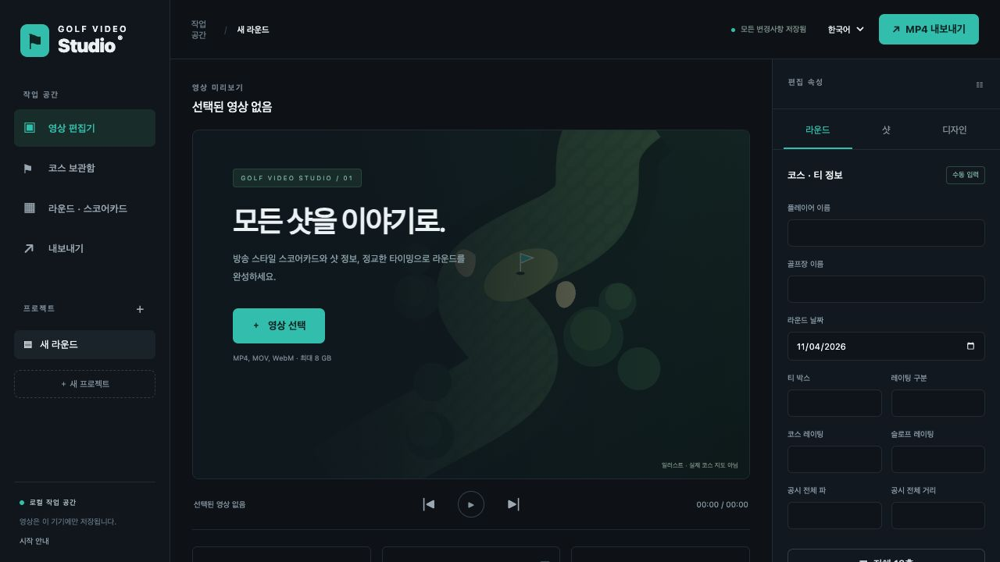

**English** | [한국어](README.ko.md)

# Golf Video Studio

A local golf-video editor for timed shot graphics, editable 18-hole scorecards and permanent MP4 overlays. Video processing and project storage run on your own device. The web editor and Expo mobile development client share one FastAPI backend and scoring model.



## Current status

| Component | Status |
| --- | --- |
| Desktop web editor | Video import/playback, round and shot editing, timeline, overlay design and saved projects implemented |
| MP4 export | Real FFmpeg H.264/AAC rendering, progress and download; shared preview/export graphics |
| Course library | Local search, tee/category selection, manual entry and authorized CSV/JSON imports |
| iOS / Android | Expo development client prepared; TypeScript checks and both JavaScript bundles passed; native builds and device validation pending |
| USGA / cloud | Live USGA integration, hosted authentication/storage and store publication pending |

**Validation:** 21 backend tests passed, including synthetic video/audio export and preview-panel comparison. Browser checks covered upload, shot overlays, autosave and completed MP4 export. See [implementation status](docs/STATUS.md) and [architecture](docs/ARCHITECTURE.md).

## Run

Requires Python 3.13+, [uv](https://docs.astral.sh/uv/) and FFmpeg **with ffprobe and libx264** on PATH.

```bash
git clone https://github.com/slee1005/scorecard.git
cd scorecard
uv sync --locked
uv run golf-video-studio
```

Open [http://127.0.0.1:8775](http://127.0.0.1:8775). Use `--port 8780` for another port. On macOS, install FFmpeg with `brew install ffmpeg`. On Windows/Linux, install FFmpeg for your platform and put both executables on PATH. No frontend build, cloud account or API key is required.

## Editing workflow

1. Create a project and import an MP4, MOV or WebM. One source video belongs to each project. Metadata includes orientation-corrected dimensions, duration, FPS and audio presence. Browser playback depends on browser codec support; H.264 MP4 is the most portable input.
2. Enter the player, course, tee, rating category, date and optional published rating/slope. Open **Round & scorecard** to enter all 18 pars, yardages and scores. Unknown values stay blank. Front/back/overall totals show entered holes only; relative-to-par includes only scored holes with a known par.
3. Add shots with club, hole, distance, remaining distance, result, notes and start/end times. Shots are automatically numbered per hole in list order. Move them up/down to reorder. Newly added shots use the next available time after the last shot; edit timestamps or drag timeline markers to move them.
4. Add a full/front/back scorecard. Select a timeline graphic and use **Design** to choose its template, adjust timing, normalized position/size, font, text/panel/accent colors, panel opacity, radius, visibility and course label. Drag panels and their resize handle directly in the preview. Save styles as project presets. Shot and scorecard panels can coexist in separate areas; timing/panel collisions are rejected.
5. Use play/pause, seek, frame steps and timeline zoom. Space toggles playback; arrow keys step frames when no form control has focus. The actual video `currentTime` controls overlay visibility with half-open `[start, end)` intervals.
6. Select **Export MP4**, choose draft/high/master quality and source/1080p/4K bounds. Source aspect ratio and audio are preserved, video is encoded as H.264/yuv420p and the first audio track as AAC. Export never upscales. Progress comes from FFmpeg; download the finished MP4 from Exports.

The same Pillow-generated RGBA panels are displayed in the browser and composited into exports. Coordinates use the actual video rectangle, including portrait clips, rather than the surrounding letterbox. For portrait videos, use front/back scorecards or enlarge the panel for legibility. The preview is a video plus transparent image layers; `requestAnimationFrame` runs only while playing. These image layers deliberately share their source with the renderer instead of maintaining a second canvas text implementation.

## Courses and data integrity

Course search searches the **saved local course library**, including name, club, city, state and ZIP. A course can contain multiple tees and rating categories. Save the current round's course configuration, or import an authorized course JSON file. Choose the exact tee/category before applying it. Confirmation is required before course values are replaced; round scores are retained.

The official [USGA course lookup](https://ncrdb.usga.org/courseTeeInfo.aspx) is linked in the app. No public API authorization was available for this project. The [WHS interoperability programme](https://www.whs.com/articles/2024/2024-interoperability.html) describes controlled access and use restrictions. There is **no automated USGA lookup, scraping, invented course data, or claim of USGA verification**. A licensed integration remains a future adapter.

Imported course snapshots are immutable references. Round overrides are stored separately; the UI marks manual overrides and exposes the original snapshot. Course imports are labeled unverified. Hole-level data must be entered or imported; totals never generate fictitious hole values.

CSV columns: `hole,par,yardage,score,handicap`. Use 1–18 unique rows, UTF-8, and integer values; empty cells clear values in supplied columns. Missing columns retain existing values. Import validation is atomic. Download an empty 18-hole template in the app. Upload PNG/JPG/PDF scorecards (up to 15 MB) for reference; OCR and automatic verification are not included.

For JSON imports, use the `Course` schema in [docs/openapi.json](docs/openapi.json), also available at `/docs`. Minimal valid input:

```json
{"name":"Your course","source_name":"User scorecard","verification":"imported","tees":[{"name":"Your tee","category":"Applicable category"}]}
```

This initializes 18 unknown holes, not guessed data. Supply `holes` with exactly one of each number 1–18 to import hole information. Optional tee fields include total `par`, `yardage`, `rating`, `slope`, `bogey_rating`, `front_rating`, `back_rating`, `front_slope`, `back_slope`. Source metadata includes `source_url`, `external_id`, city/state/country/ZIP and update time. To refresh a course, import a new saved version and explicitly apply its tee; originals remain preserved.

## Storage and API

Projects and reusable courses are stored in `~/.golf-video-studio/studio.sqlite`; source videos/references/exports live in its `projects/<id>/` directory. Set `GVS_HOME` to an independent data directory (always do this for experiments). `GVS_MAX_UPLOAD_MB` defaults to 8192. JSON project backups can be downloaded from **Getting started**. A backup does not include source video; copy the data directory while the server is stopped for a complete backup.

All APIs use `/api/v1`; interactive API documentation is at `/docs`. SQLite revisions prevent stale updates: `PUT /projects/{id}` requires the last revision and returns 409 on a conflict. The UI retains the conflicting draft in memory and offers JSON download before reload. There is a single render worker and at most three queued/running exports. Export jobs persist; interrupted jobs are marked failed on restart. Completed exports older than 24 hours are removed on next startup; source videos are retained. Temporary rendering assets are removed after each job.

The server binds **127.0.0.1 only**. It rejects other Host values and cross-origin requests. There are no outbound backend requests, user accounts, telemetry, cloud storage or production authentication. Do not expose this unauthenticated development server to the internet.

## Mobile development

`mobile/` contains an Expo SDK 56 / React Native / TypeScript development client with Home, Courses, Rounds, Videos and Profile screens. It uses generated API types and the same backend, course library, score calculations and exported overlay PNGs. SQLite caches projects/courses and queues offline round/shot edits. Sync uses revisions, retains conflicts and requires explicit draft discard to accept newer server data. Totals remain the last server totals while offline; no second scoring engine exists on the phone.

```bash
cd mobile
npm ci
npm run typecheck
npm run ios       # macOS + Xcode + simulator
# or: adb reverse tcp:8775 tcp:8775
npm run android   # Android SDK / emulator or attached device
```

Use development builds, not Expo Go alone. `lib/repository.ts` uses loopback at port 8775: iOS simulator or Android `adb reverse` can reach the desktop backend. A physical iPhone cannot access this loopback server directly. Application identifiers are **development placeholders**; replace them with owned identifiers before release. `eas.json` prepares development APK, internal preview and production AAB profiles; no signing credentials, EAS project or publication is assumed.

Native code includes device document-video selection, actual upload progress, playback, saved overlay preview, server export submission/progress and download links. The web editor supplies detailed timing/design. Native builds/device behavior and offline conflict interaction still need device validation. Authentication/SecureStore, HTTPS multi-user hosting, private cloud storage, background/resumable upload, push notifications, touch overlay design, local language support and store release are **not implemented**. See [docs/STATUS.md](docs/STATUS.md).

## Verification

```bash
uv run pytest
cd mobile
npm ci
npm run typecheck
npx expo install --check
npx expo export --platform ios --platform android
```

Tests cover scoring and partial-round totals, score categories, shot numbering, half-open visibility, collisions/bounds, optimistic concurrency, atomic CSV imports, course snapshots/overrides, Host/Origin checks, RGBA panels, portrait proportions, restart recovery, and a real FFmpeg MP4 export with synthetic video/audio. The export test checks codecs, audio/video start and duration, timed graphic presence/absence and frame similarity with the shared preview panel. No test video is committed. Mobile JS bundling is not a signed native build or on-device test.

## Structure

- `src/golf_video_studio/models.py`: validated domain/timeline/style models and scoring.
- `storage.py`: SQLite persistence, revisions, courses and jobs.
- `graphics.py`: shared overlay raster generation.
- `rendering.py`: probing, job queue, FFmpeg processing and recovery.
- `api.py`: local HTTP API and streaming file responses.
- `web/`: responsive English/Korean editor, no build step.
- `mobile/`: Expo development client and offline repository.
- `docs/`: API contract, architectural decisions and explicit completion status.

The Python dependencies are locked with `uv.lock`; mobile dependencies with `package-lock.json`. FFmpeg is an external prerequisite. Source input codecs and fonts vary by system; install a Korean-capable font on Linux/Windows when rendering Korean labels. Player comparison, multi-video assembly, waveform editing, HDR preservation, OCR and cloud/mobile production features are future work.
